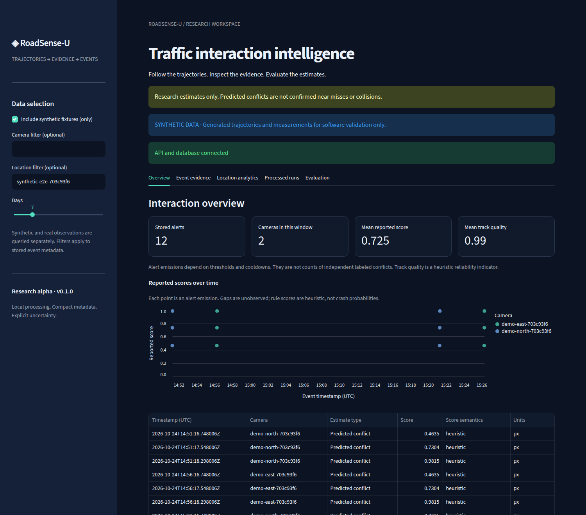
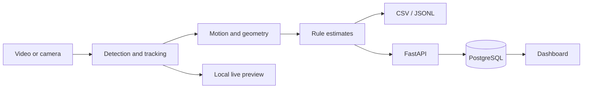
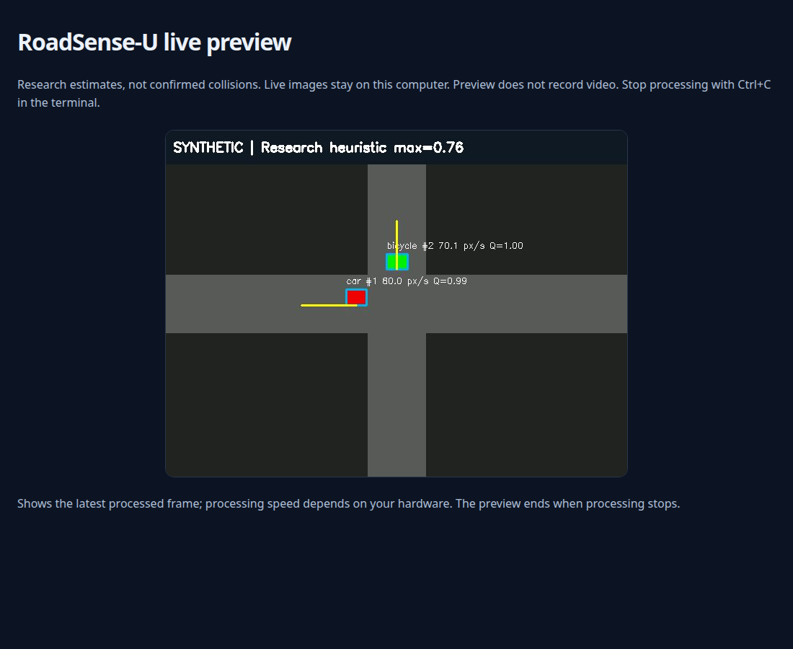
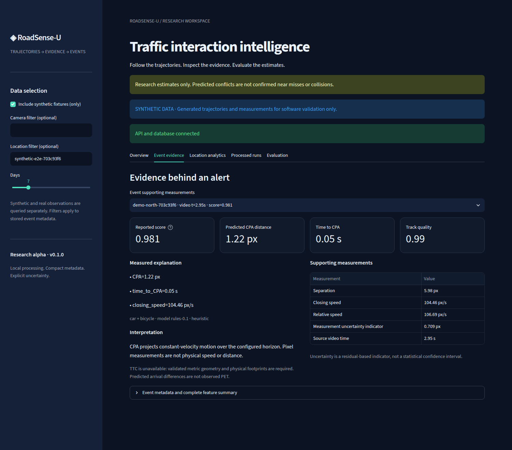
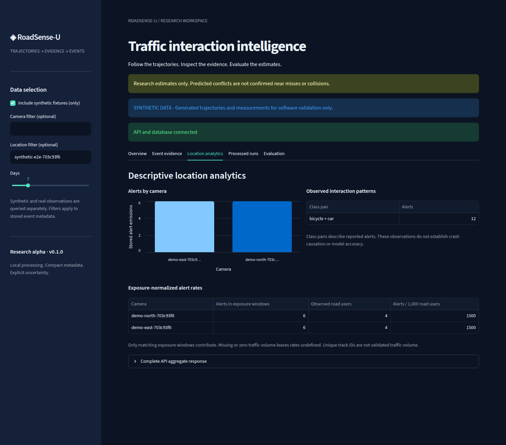
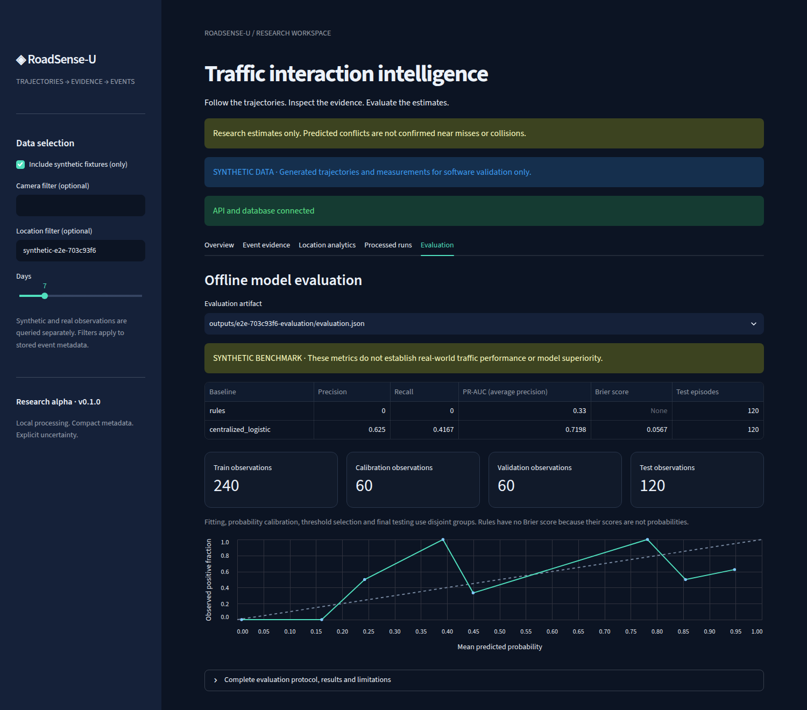

# RoadSense-U

Camera-based traffic interaction analysis with local video processing, a PostgreSQL event API, and a browser dashboard.

[Quick start](#quick-start) · [Live preview](#live-preview) · [Testing](#testing) · [Architecture](docs/ARCHITECTURE.md) · [Contributing](CONTRIBUTING.md)



*The five screenshots in this README show the running application using synthetic fixtures. They demonstrate the software workflow, not real-world detection accuracy.*

## Features

- **Video input:** MP4/AVI files, USB/laptop webcams, and reachable HTTP/RTSP camera streams.
- **Detection and tracking:** optional YOLO11n and ByteTrack for cars, motorcycles, buses, trucks, bicycles, and pedestrians.
- **Motion analysis:** timestamped trajectories, causal smoothing, velocity, acceleration, closest approach, and trajectory quality.
- **Calibration:** image coordinates by default; optional manually validated ground-plane mapping for approximate metric measurements.
- **Event service:** authenticated FastAPI endpoints, PostgreSQL persistence, idempotent submissions, camera filters, exposure statistics, and retention controls.
- **Dashboard:** event timeline, supporting measurements, camera comparisons, processing artifacts, and offline model evaluation.
- **Local-first defaults:** footage recording is opt-in; the client sends event metadata rather than video frames.

**Status: research alpha.** See the [validation status](docs/VALIDATION_STATUS.md) for executed evidence and missing research prerequisites. Rule scores are heuristic interaction estimates, not collision probabilities. The project has not been validated as a collision-warning system. Physical webcam/phone operation and moving real-world traffic accuracy still need validation.

An [externally labeled collision pilot](docs/LABELLED_COLLISION_PILOT.md) exposed low measurement coverage and a participant-association failure. Its scene-level temporal matches do not establish correct collision warnings. Pair-level near-miss accuracy and unseen-camera generalization remain unverified.



## Quick start

Requires Python 3.11–3.13 and Docker Compose. The demo runs on CPU without a camera, pretrained weights, or a cloud account. Local tests used Python 3.12.

```bash
git clone https://github.com/aiopensourcedata/roadsense-u.git
cd roadsense-u
python3 -m venv .venv
source .venv/bin/activate
python -m pip install --upgrade 'pip>=26.2,<27' 'setuptools>=84.1.0,<85'
pip install -e '.[dashboard]'

python scripts/init_local_env.py
docker compose up -d --build --wait
python scripts/generate_synthetic_data.py
python scripts/run_video.py data/synthetic/crossing.avi \
  --synthetic --submit --output outputs/demo-01
```

Open the [dashboard](http://localhost:8501) and enable **Include synthetic fixtures (only)**. The [API health check](http://localhost:8000/health) and [API reference](http://localhost:8000/docs) are also available locally.

The synthetic demo uses a color-component detector and gated tracker designed for the generated fixture. It does not exercise YOLO/ByteTrack or measure real-world accuracy.

The initializer creates private local credentials in `.env` and refuses to overwrite an existing file. Choose a new output directory for each run. Stop services with `docker compose down`; the database volume persists.

### Run on your own video

Install the optional detector dependencies and download the pinned model:

```bash
pip install torch torchvision --index-url https://download.pytorch.org/whl/cpu
pip install -e '.[vision]'
python scripts/download_weights.py
python scripts/run_video.py /path/to/traffic.mp4 \
  --submit --output outputs/traffic-01
```

CPU operation is supported; GPU acceleration is optional. Missing dependencies or weights raise an error. The downloader verifies a pinned checksum from a reviewed upstream download; it is not an independent publisher signature. See [third-party notices](THIRD_PARTY_NOTICES.md) for model and dependency terms.

| Input | Command/source |
|---|---|
| Video file | `python scripts/run_video.py /path/to/traffic.mp4` |
| Laptop/USB webcam | `python scripts/run_webcam.py 0` |
| Phone camera stream | `python scripts/run_webcam.py 'http://PHONE_IP:PORT/video'` |

Phone input requires a compatible streaming app and network connection. See [usage](docs/USAGE.md) for configuration and calibration.

## Live preview

```bash
python scripts/run_webcam.py 0 --preview --output outputs/live-01

# Or watch the generated five-second clip:
python scripts/run_video.py data/synthetic/crossing.avi \
  --synthetic --preview --output outputs/preview-01
```

Open [127.0.0.1:8765](http://127.0.0.1:8765) while processing runs. The preview shows annotated frames, track IDs, trajectories, and measurements. It holds the latest JPEG in memory and stops at end of input or Ctrl+C. Use `--preview-port 8766` if the port is busy.



Recording requires `--save-video`. Preview frame rate depends on inference throughput and source buffering. Keep the viewer on loopback; it is not an authenticated remote video service.

For small or distant objects, try `--inference-size 960` with either video or webcam commands. The default remains 640; larger sizes use more compute and do not guarantee better tracking or warnings. Bounding boxes and pixel measurements stay in the original image coordinates. Sizes must be multiples of 32 between 320 and 1920.

## Event measurements

The **Event evidence** tab shows the values behind each alert, including closest approach, time to closest approach, closing speed, track quality, and residual-based uncertainty.

New runs also export `event_geometry.jsonl`, linked by event ID, and pair projections in `features.jsonl`. In **Processed runs**, select a run and inspect its **Local pair geometry** chart: measured anchors and constant-velocity projected anchors are distinct. These track pairs remain unverified; the midpoint is not a confirmed collision location. Nested experiment runs are supported. See the [perception development protocol](docs/PERCEPTION_DEVELOPMENT.md).

For actor-level diagnostics, the [offline annotation workflow](docs/ACTOR_REVIEW.md) separates raw detections from tracked boxes, provides a score-blind box editor, and rejects blank or incomplete labels before evaluation. Model output counts are not actor ground truth.



Measurements remain in pixels unless a valid calibration is supplied. TTC is unavailable in the video pipeline when physical footprints are unknown. Predicted arrival differences are not reported as observed post-encroachment time (PET). Definitions and assumptions are in [architecture](docs/ARCHITECTURE.md).

### Output files

| File | Contents |
|---|---|
| `trajectories.csv` | Timestamp, class, track ID/epoch, box, position, motion, units, and quality flags. |
| `features.jsonl` | Pairwise measurements, identity ambiguity evidence, and abstention reasons. |
| `frame_timestamps.csv` | Complete processed-frame timeline, including frames without detections. |
| `event_evaluation.jsonl` | Retrospective future-horizon coverage; gaps and truncated endings are censored. |
| `events.jsonl` | Emitted events with UUIDs for idempotent replay. |
| `report.json` | Configuration, counts, timing, resource use, and attempted metadata-body bytes. |
| `annotated.mp4` | Recorded only with `--save-video`. |

If submission fails, replay retained metadata:

```bash
python scripts/replay_events.py outputs/demo-01/events.jsonl
```

The [identity and coverage guide](docs/IDENTITY_AND_COVERAGE.md) explains the causal ambiguity check, its limits, and gap-aware evaluation. Real-data baseline CSVs require explicit future-observation coverage; missing outcomes must not be labeled as negatives.

## Camera and location analytics

The dashboard groups stored alerts by camera, location, and interaction type. Normalized rates require supplied traffic volume from matching observation windows; missing exposure leaves the rate undefined.



The fixture replays a two-agent crossing at two fictional cameras. A short cooldown produces repeated alert emissions per episode. These counts are not independent conflicts, evidence of a dangerous location, or causal findings.

## Baselines and evaluation

The offline baseline predicts a labeled conflict within the next three seconds from features available at the prediction timestamp. Fitting, calibration, threshold selection, and testing use disjoint groups, with event/clip/location overlap checks.

```bash
python scripts/train_baseline.py data/synthetic/benchmark.csv \
  --output outputs/benchmark-01
```



The screenshot shows an executed synthetic tabular experiment, separate from the video fixture. It does not establish real-world performance. Rule scores have no Brier score because they are not probabilities; calibrated logistic regression is currently an offline model.

Metrics include precision/recall, average precision, validation-selected false-positive budgets, Brier score, reliability bins, event warning time, cluster-bootstrap intervals, and abstention coverage. See the [experiment plan](docs/EXPERIMENT_PLAN.md) for definitions and the [literature review](docs/RESEARCH_GAP.md) for related work. Temporal models, federated learning, MQTT, and object storage are not implemented.

## Testing

Local verification on **2026-10-24**: **41 automated tests** and **16 browser/API/PostgreSQL checks** passed. The browser run persisted 12 computed synthetic alert emissions and captured every screenshot above. [Capture manifest](docs/assets/provenance.json).

Subsequent checks on **2026-10-27** passed **80 automated tests**. The [published-label collision comparison](docs/LABELLED_COLLISION_PILOT.md) includes 28 source clips and eight fresh test sources; it exposes low coverage and does not establish learned warning improvement. Historical synthetic screenshots and browser checks remain separate from that experiment.

```bash
pip install -e '.[dev,dashboard,e2e]'
pytest -q
ruff format --check src scripts tests
ruff check src scripts tests

# Browser suite: uses installed Chrome/Chromium, or install it first.
python -m playwright install chromium
docker compose up -d --build --wait
python scripts/run_e2e.py
```

The browser suite checks computed video events against an independent PostgreSQL query, authentication, malformed requests, size limits, duplicate replay, synthetic/real isolation, exposure normalization, dashboard controls, mobile layout, and live MJPEG. Reports go to `outputs/e2e-*/results.json`.

Unit tests need no camera, Docker, browser, or model weights. Browser tests need running services and optional extras. Use `--screenshots docs/assets` to refresh the gallery and its hashes. See [E2E testing](docs/E2E_TESTING.md) for details.

For local visual annotation, see the [review protocol](docs/ANNOTATION_PROTOCOL.md). The preparation tool selects continuous windows without outcome labels and creates a score-hidden review page; first-pass notes are not validated ground truth.

## Development

The package separates input, perception, calibration, motion, risk, cloud services, analytics, and evaluation under `src/roadsense/`. Scripts provide processing and experiment entry points; tests cover calculations and service boundaries.

| Documentation | Contents |
|---|---|
| [Architecture](docs/ARCHITECTURE.md) | Data flow, geometry, calibration, and persistence. |
| [Usage](docs/USAGE.md) | Camera commands, configuration, and offline evaluation. |
| [Datasets](docs/DATASETS.md) | Access requirements, licenses, and annotations. |
| [Research gap](docs/RESEARCH_GAP.md) / [Experiment plan](docs/EXPERIMENT_PLAN.md) | Prior work and proposed validation. |
| [Privacy](docs/PRIVACY.md) / [Security](SECURITY.md) | Retention, deletion, reporting, and deployment boundaries. |
| [Project status](docs/PROGRESS.md) / [Release checklist](docs/OPEN_SOURCE_READINESS.md) | Completed checks and outstanding work. |

Bug reports and focused contributions are welcome; see [CONTRIBUTING.md](CONTRIBUTING.md). Keep credentials, datasets, recordings, weights, and generated artifacts out of commits. Remote deployments require HTTPS and additional operational controls; the Compose setup is for local development.

## License

[AGPL-3.0-only](LICENSE). External models, datasets, and dependencies retain their [own terms](THIRD_PARTY_NOTICES.md). See [citation metadata](CITATION.cff) when referencing the software.
