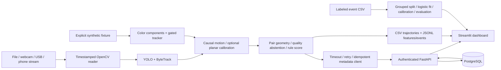

# Architecture

## Implemented data flow

Camera ingestion, detection, motion, risk, API, analytics, dashboard and evaluation are separate modules. CPU is the default. The synthetic detector is explicitly selected and never substitutes for missing weights. A YOLO model is instantiated per run/camera; tracking state must not be shared across cameras. Reconnection resets tracker and motion histories. Device absence raises a clear error; file corruption before the advertised end raises; zero-frame decodes must be treated as failures. No physical camera is required for offline development.

Trajectories use bottom-center boxes, a causal trailing one-second linear fit, timestamp velocity and successive fitted-velocity acceleration. A gap over 0.5 seconds or unit change resets motion history. Detection confidence is not identity confidence. Quality combines detection confidence with trajectory residual; no separately calibrated tracking confidence is available. Possible jumps are flagged heuristically; ID-switch accuracy, camera movement detection and occlusion reasoning require annotated sequences and remain incomplete.

## Geometry definitions

Let r=pB−pA and v=vB−vA in one common coordinate system. Distance is ||r||; relative speed is ||v||; signed closing speed is −r·v/||r||. For horizon H, tCPA=clip(−r·v/||v||²,0,H) when motion is nonzero, and CPA distance is ||r+v tCPA||. Zero relative motion gives tCPA=0 and current separation. Predictions assume constant velocity; CPA at the horizon boundary is a minimum within that horizon, not an unconstrained future minimum.

For nonparallel nonzero paths, solve [vA,−vB][tA,tB]ᵀ=pB−pA. Report shared-point arrivals only when both times are forward and inside the horizon. |tA−tB| is an arrival difference, not PET.

With validated metric coordinates and externally known combined disk radius R, first-contact TTC solves ||r+vt||²=R² for the smallest nonnegative root. Diverging/no-intersection pairs return null; overlapping disks yield zero. Pipeline physical footprints are unknown, so the pipeline does not supply a radius or report TTC. A measured PET requires observed nonoverlapping occupancy intervals in the same conflict area: second entry minus first exit. The helper validates interval ordering; establishing actual zone geometry and reliable exits is the caller's responsibility. No automated PET is claimed.

The rule score is exp(−0.5(dCPA/scale)²)×max(0,1−tCPA/H), conditional on closing motion and sufficient quality. It is a dimensionless heuristic, **not a calibrated crash probability**. Reason strings show measured CPA, time and closing speed. Reliability rejects poor tracks or measurement uncertainty larger than the configured proximity scale. Residual sums are heuristic uncertainty indicators, not confidence intervals. Changing thresholds changes alert counts. Per-pair cooldown reduces duplicate alerts but does not fully segment interactions into labeled events.

## Calibration

Homography fitting requires four or more distinct noncollinear known point pairs on a fixed approximately planar road. At least two independent validation points and a declared positive metric error are required. Metric projection is restricted to the calibration hull and rejected when invalid. Units can revert to pixels outside the hull; those histories reset and mixed-unit pairs are skipped. Fit/validation error is not a proof of metric accuracy throughout the scene. Lens distortion, slope, rolling shutter, moving cameras, network timing and inconsistent bottom contact points remain limitations. No automatic moving-camera compensation is implemented; dashcam datasets cannot directly validate fixed-plane motion without additional ego-motion handling.

## Cloud and persistence

Events have UUID, run/session UUID, tracking epoch, camera, location, aware timestamp, source-relative time, event type, score semantics, model version, pair classes/IDs, bounded feature summaries and a synthetic flag. File wall timestamps default to ingestion-start plus relative time; supply actual capture start when known. Reprocessing creates a new session; deduplicating the same source across runs is not implemented.

POST /events is UUID-idempotent; a conflicting reused UUID returns 409. GET /events paginates and filters camera/location/time/synthetic status. GET /stats requires a time window and bounds result size. POST /exposures accepts manually counted or validated crossing exposure; it rejects overlapping windows in serial requests. Counts normalize only events inside fully included matching exposure windows. Track segments are not traffic exposure. Reconnection clears alert cooldowns and increments a tracking epoch so reused detector IDs remain distinguishable. Concurrent overlap checks and writes are serialized using per-camera PostgreSQL transaction advisory locks, or an immediate SQLite transaction. Writers bypassing this repository can still violate the invariant; direct database writes are outside the API contract. Trend changes concern observed dates, not complete continuous coverage. Performance comparisons by camera require labels; mean heuristic scores are not model accuracy.

API keys protect all data and maintenance endpoints; health is public. Schema creation is for fresh prototype databases; migrations, per-camera authorization and multi-user roles are future work. Raw body limits are enforced before parsing, including chunked bodies. Reverse proxy read timeouts, connection limits and rate limiting remain deployment responsibilities. Remote client URLs require HTTPS; `api` is an explicit Compose-internal HTTP exception. Client counts attempted JSON-body bytes, excluding headers/TLS. Retries are bounded; JSONL UUID replay is available. Submission failures are reported rather than silently replaced.

Metadata retention purges at API startup and POST /maintenance/purge. Schedule purge externally for continuous retention enforcement; offline outputs and backups need separate expiry. Storage and MQTT interfaces are optional contracts, not implemented integrations. No raw footage upload is present.

Live reports retain only the latest 10,000 processing latencies for p50/p95 and state that sampling window explicitly; throughput/CPU accounting spans the run. Track-segment counts avoid retaining every historical detector ID in memory and must not be interpreted as unique traffic volume. Daily statistics use UTC dates.

Pair identity is checked causally using sustained same-class box overlap and agreement of normalized relative motion. Ambiguous pairs abstain without removing detections or changing IDs. This can also abstain on genuine occlusion. Completed runs export all frame timestamps and retrospective event-horizon coverage; missing future intervals never become negative labels automatically. See [identity and coverage](IDENTITY_AND_COVERAGE.md) for parameters, artifacts, limitations and data contracts.
